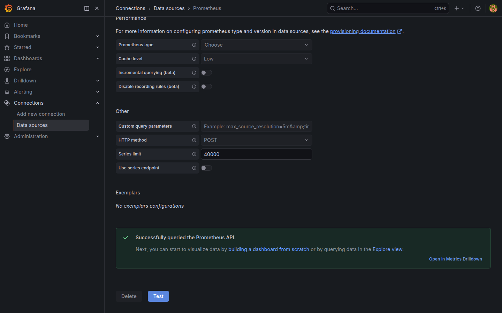
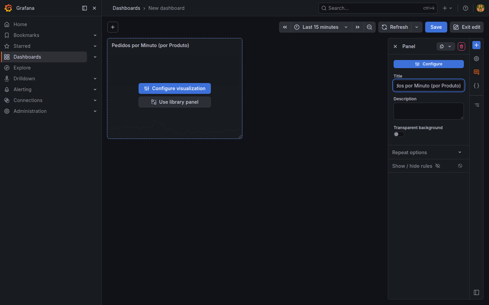
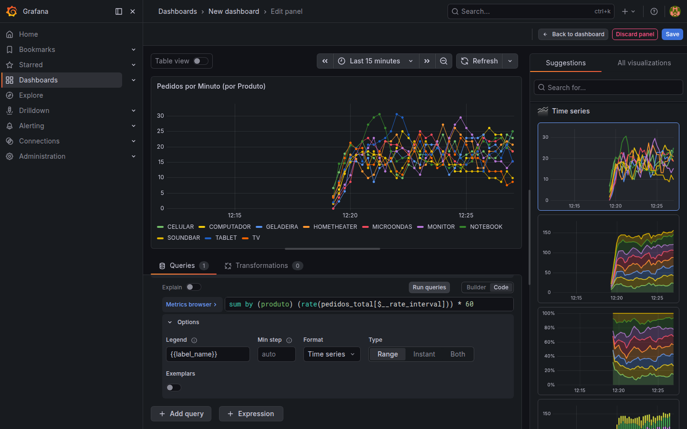
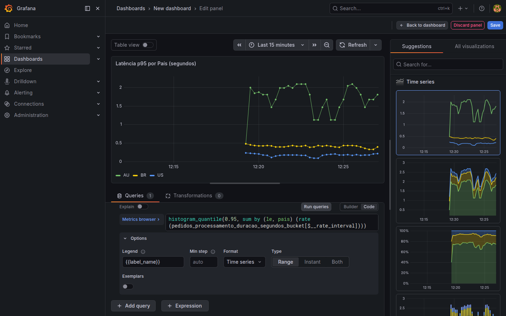
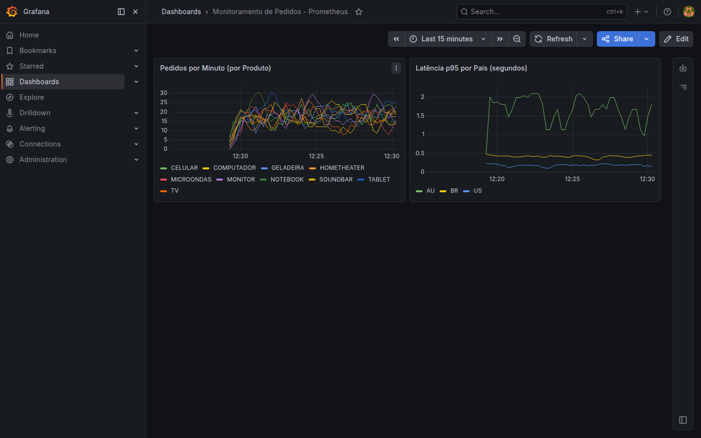

# Monitoramento de Séries Temporais com Prometheus

Author: Prof. Barbosa<br>
Contact: infobarbosa@gmail.com<br>
Github: [infobarbosa](https://github.com/infobarbosa)

O objetivo deste laboratório é oferecer ao aluno um ambiente de familiarização com o modelo de monitoramento e armazenamento de séries temporais utilizando **Prometheus**.

## Introdução

[Prometheus](https://prometheus.io/docs/introduction/overview/) é um sistema open source de monitoramento e banco de dados de séries temporais desenvolvido originalmente pelo SoundCloud e hoje graduado pela Cloud Native Computing Foundation (CNCF). Ele coleta métricas periodicamente via HTTP a partir dos serviços monitorados (**modelo Pull / *scrape***), armazena-as em seu motor local (**TSDB**) e disponibiliza uma linguagem de consulta funcional própria chamada **PromQL**.<br>
> Fonte: [Wikipedia](https://en.wikipedia.org/wiki/Prometheus_(software))

### O motor do Prometheus (por que ele é diferente)

Duas escolhas arquiteturais definem o Prometheus:

1. **Coleta ativa (*Pull / Scrape*):** em vez de os aplicativos empurrarem eventos a cada ocorrência, cada serviço expõe um endpoint HTTP (`/metrics`) em texto simples com o estado atual de seus contadores e medidores. O Prometheus visita cada alvo (*target*) em um intervalo fixo (`scrape_interval`) e grava uma fotografia (*sample*) com o timestamp da coleta.
2. **Motor TSDB local otimizado para métricas:**
   - **Head Block (em memória) + WAL (*Write-Ahead Log*):** as amostras recentes entram no *Head Block* em RAM e são gravadas sequencialmente no WAL em disco para durabilidade.
   - **Blocos imutáveis em disco:** periodicamente o *Head Block* é compactado em diretórios imutáveis (`01.../`), contendo os `chunks/` (séries comprimidas), o `index` (índice invertido de labels → séries) e o `meta.json`.
   - **Compressão Gorilla / XOR:** inspirada no paper *Gorilla* (Facebook/Meta), usa *delta-of-delta* para timestamps e compressão XOR bit a bit para valores `float64` — reduzindo cada amostra a poucos **bytes** em disco, como veremos na [Seção 9](#9-por-dentro-do-armazenamento-tsdb-wal-e-compressão-gorilla-hands-on).

```text
[pedidos-exporter :9100/metrics] <--- scrape Pull (5s) --- [Prometheus :9090 (TSDB)] ---> [Grafana :3000]
                                                                     ^
[Batch job / curl] --- push (HTTP POST) ---> [Pushgateway :9091] ----+
```

> **Quando usar o Pushgateway?** O modelo padrão do Prometheus é **Pull**. O **Pushgateway** existe apenas para **jobs efêmeros ou em lote (*batch*)** que terminam rápido demais para serem raspados diretamente — ele **não** deve ser usado como coletor contínuo de eventos. Neste laboratório usaremos o modelo **Pull** para o fluxo contínuo de pedidos e o **Pushgateway** para simular um job de fechamento manual ([Seção 5](#5-enviando-métricas-manualmente-com-pushgateway)).

### Prometheus × InfluxDB 3 (quando usar cada um)

Se você também cursou o laboratório de [InfluxDB 3](https://github.com/infobarbosa/influxdb-timeseries-demo), vale contrastar o propósito de cada ferramenta:

| Dimensão | **Prometheus** | **InfluxDB 3** |
|---|---|---|
| **Caso de uso principal** | Monitoramento operacional, métricas agregadas e alertas | Séries temporais de eventos, telemetria IoT e análise histórica |
| **O que representa cada ponto** | Estado de um contador/medidor no instante do scrape | Um evento individual (ex.: cada pedido com seu timestamp) |
| **Modelo de ingestão** | **Pull** (scrape HTTP periódico); Push apenas via Pushgateway para batch | **Push** (escrita ativa via Line Protocol / HTTP API) |
| **Armazenamento em disco** | TSDB próprio (WAL + chunks **Gorilla/XOR** + índice invertido) | Colunar aberto (**Apache Arrow** em RAM + **Apache Parquet** em disco) |
| **Linguagem de consulta** | **PromQL** (vetores instantâneos e de intervalo) | **SQL** padrão (via Apache DataFusion) |
| **Alta cardinalidade** | **Crítica** (cada combinação de labels cria uma série no índice em RAM) | Muito mais tolerante (armazenamento colunar em Parquet) |

---

## Exposition Format e Modelo de Dados

O Prometheus define um formato de texto simples para exposição de métricas chamado **Exposition Format**. Qualquer serviço que responda nesse formato em um endpoint HTTP pode ser monitorado.

### Sintaxe

```text
# HELP <metric_name> <descrição legível>
# TYPE <metric_name> <tipo>
<metric_name>{<label_key>="<label_value>"[,...]} <valor> [<timestamp_ms>]
```

Onde:

- `# HELP` (recomendado) — descrição legível da métrica.
- `# TYPE` (recomendado) — tipo da métrica: `counter`, `gauge`, `histogram`, `summary` ou `untyped`.
- `<metric_name>` (obrigatório) — nome da métrica (`[a-zA-Z_:][a-zA-Z0-9_:]*`). Convenção oficial: `<namespace>_<nome>_<unidade>[_total]` (ex.: `pedidos_receita_reais_total`).
- `{<label_key>="<label_value>"}` (opcional) — conjunto de rótulos (**labels**) chave-valor que identificam as dimensões da série. Valores são sempre strings entre aspas duplas.
- `<valor>` (obrigatório) — número em ponto flutuante `float64` (ex.: `42`, `0.215`, `NaN`, `+Inf`).
- `[<timestamp_ms>]` (opcional) — timestamp em milissegundos desde Unix epoch. Quando omitido, o Prometheus usa o instante do scrape.

**Exemplo:**
```text
# HELP pedidos_total Total acumulado de pedidos recebidos
# TYPE pedidos_total counter
pedidos_total{departamento="ELETRODOMESTICOS",pais="BR",produto="GELADEIRA"} 11
# HELP pedidos_estoque_atual Quantidade atual disponivel em estoque por produto
# TYPE pedidos_estoque_atual gauge
pedidos_estoque_atual{departamento="ELETRODOMESTICOS",produto="GELADEIRA"} 28
```

### Tipos de métricas

| Tipo | Comportamento | Funções típicas em PromQL | Exemplo no lab |
|---|---|---|---|
| **Counter** | Valor monotônico que **só aumenta** (ou zera ao reiniciar o processo) | `rate()`, `increase()` | `pedidos_total`, `pedidos_itens_total`, `pedidos_receita_reais_total` |
| **Gauge** | Valor instantâneo que **sobe e desce** | `avg_over_time()`, `delta()`, `min_over_time()` | `pedidos_estoque_atual` |
| **Histogram** | Conta observações em faixas cumulativas (`_bucket`, `_sum`, `_count`) | `histogram_quantile()` | `pedidos_processamento_duracao_segundos` |
| **Summary** | Quantis calculados no próprio cliente (não agregáveis entre instâncias) | consulta direta | — |

### Labels e Alta Cardinalidade — o conceito mais importante no Prometheus

No Prometheus, **uma série temporal** é identificada unicamente pela combinação:

```text
nome_da_metrica + conjunto_exato_de_labels
```

No nosso laboratório, `pedidos_total` possui `10` produtos × `3` países (cada produto pertence a 1 departamento fixo) = **`30` séries temporais**. Já o histograma `pedidos_processamento_duracao_segundos_bucket` possui `7` limites (`le`) × `3` países = **`21` séries**.

> ⚠️ **Cuidado com alta cardinalidade!** Cada série ativa ocupa memória no *Head Block* e entradas no **índice invertido** (`postings`). Nunca coloque valores ilimitados como **label** — como `id_do_pedido`, `cpf`, `email` ou `ip_do_cliente`. Se você tiver 1 milhão de pedidos com `id_do_pedido` como label, criará 1 milhão de séries e esgotará a RAM do Prometheus. Regra prática: labels devem ter **domínio pequeno e conhecido** (país, departamento, produto, código HTTP). Veremos essa contagem ao vivo na [Seção 9.5](#95-índice-invertido-e-cardinalidade-ao-vivo).

---

## Laboratório

### 1. Ambiente

Este laboratório é executado em uma instância **AWS EC2** (`t3.medium`) provisionada automaticamente via **AWS CloudShell**.<br>
A instância executa dois containers Docker:
- **`prometheus-lab`**: o **code-server** (Visual Studio Code direto no navegador), o **Prometheus** (`+ promtool`), o **Pushgateway** e o **exporter de pedidos** (veja a Seção 2).
- **`grafana`**: a plataforma de visualização de dashboards, explorada na seção bônus ao final do laboratório.

Todos os comandos do tutorial são executados no terminal do code-server.

> **ATENÇÃO:**
> 1. **Região:** Utilize sempre a região **Norte da Virgínia (`us-east-1`)** no Console AWS.
> 2. **Custos:** A instância EC2 e o volume EBS consomem créditos do seu laboratório AWS Academy. Ao encerrar a aula, garanta que a instância esteja parada (**Stopped**) ou aguarde o desligamento automático da sessão.
> 3. **Não recrie a máquina para continuar o trabalho:** cada execução do `launch-lab.sh` cria uma instância **nova e vazia**, com data e hora no nome. Se a sua instância já existir, siga as instruções de [Retomando o laboratório](#retomando-o-laboratório). Se precisar mesmo recriar, encerre a anterior (**Instance state** > **Terminate instance**) para não consumir créditos.

#### Passo 1: Abrir o AWS CloudShell
1. Faça login no Console da AWS através do seu painel do AWS Academy.
2. Certifique-se de que a região selecionada no canto superior direito é **N. Virginia (`us-east-1`)**.
3. No topo do console, clique no ícone do **AWS CloudShell** (`>_`) ao lado da barra de pesquisa.
4. Aguarde o terminal do CloudShell carregar.

#### Passo 2: Executar o script de provisionamento
No terminal do CloudShell, execute:
```bash
curl -sS https://raw.githubusercontent.com/infobarbosa/prometheus-docker-demo/main/launch-lab.sh | bash
```

O script realizará de forma automatizada:
- Descoberta da VPC padrão e de uma Subnet pública.
- Criação do Security Group `lab-prometheus-sg` liberando as portas `8080` (IDE), `9090` (Prometheus Web UI), `3000` (Grafana) e `22` (SSH).
- Lançamento de uma nova instância EC2 `lab-prometheus-demo-AAAA-MM-DD_HH_MI_SS` (`t3.medium`, Ubuntu 24.04, 20 GB gp3).
- Instalação do Docker e inicialização dos containers `prometheus-lab` e `grafana`.
- Exibição do IP público e dos links de acesso.

#### Passo 3: Acessar a IDE
1. Abra no navegador o link da IDE exibido ao final do script: `http://<IP-PUBLICO>:8080`.
2. Caso a página não responda, **aguarde de 3 a 5 minutos** para que o Docker conclua o download das imagens e atualize o navegador.
3. O code-server abrirá diretamente na IDE, sem solicitar senha.
4. Abra um terminal: menu superior (três linhas horizontais) > **Terminal** > **New Terminal**.

Verifique se o Prometheus e o `promtool` estão disponíveis:
```bash
prometheus --version
promtool --version
```

Output esperado (a versão pode variar):
```text
prometheus, version 3.16.0 (branch: HEAD, revision: e2e28adeee2c5883d000fc82aca6008cfbf7e96d)
...
promtool, version 3.16.0 (branch: HEAD, revision: e2e28adeee2c5883d000fc82aca6008cfbf7e96d)
...
```

#### Retomando o laboratório
Se a sessão do AWS Academy expirar, a instância será parada. **Não execute o `launch-lab.sh` novamente:** ele criaria uma instância nova, sem o seu trabalho.
1. No Console AWS (`us-east-1`), acesse **EC2** > **Instances**.
2. Selecione a sua instância **`lab-prometheus-demo-<data e hora>`** (se houver mais de uma, a mais recente) e clique em **Instance state** > **Start instance**.
3. Aguarde o status **Running** e copie o novo **Public IPv4 address** (ele muda a cada reinício).
4. Acesse `http://<NOVO_IP_PUBLICO>:8080`. Os containers reiniciam automaticamente, os blocos do TSDB são preservados e o exporter de pedidos volta a gerar métricas.

---

### 2. O exporter de pedidos (modelo Pull na prática)

Assim que o container `prometheus-lab` inicia, um serviço chamado **`pedidos-exporter`** começa a simular **3 pedidos por segundo** (um por país: `BR`, `US`, `AU`), escolhendo entre 10 produtos distribuídos em 3 departamentos (`ELETRONICOS`, `ELETRODOMESTICOS`, `INFORMATICA`).

Em vez de empurrar cada pedido para o banco, o exporter mantém métricas agregadas em memória e as expõe no endpoint HTTP `http://127.0.0.1:9100/metrics`:

- **`pedidos_total`** (`counter`) — métrica de **negócio**: total acumulado de pedidos por `produto`, `departamento` e `pais`.
- **`pedidos_itens_total`** (`counter`) — métrica de **negócio**: total acumulado de itens vendidos.
- **`pedidos_receita_reais_total`** (`counter`) — métrica de **negócio**: receita acumulada em reais.
- **`pedidos_estoque_atual`** (`gauge`) — métrica de **negócio/operação**: estoque atual por `produto` e `departamento` (diminui com vendas e sobe com reposições automáticas).
- **`pedidos_processamento_duracao_segundos`** (`histogram`) — métrica **técnica (desempenho/latência)**: tempo que o serviço leva para processar e confirmar cada pedido em cada país (`US`, `BR`, `AU`), simulando perfis distintos de infraestrutura/rede por região.

Acompanhe o log do exporter:
```bash
tail /var/log/lab/pedidos.log
```

Output esperado:
```text
2026-11-22T22:50:02Z Iniciando pedidos-exporter em http://127.0.0.1:9100/metrics (3 pedidos/s)
```

Inspecione diretamente o **Exposition Format** servido pelo exporter (exatamente o texto que o Prometheus coleta a cada 5 segundos):
```bash
curl -s http://localhost:9100/metrics | head -n 20
```

Output esperado:
```text
# HELP pedidos_total Total acumulado de pedidos recebidos
# TYPE pedidos_total counter
pedidos_total{departamento="ELETRONICOS",pais="AU",produto="CELULAR"} 2
pedidos_total{departamento="ELETRONICOS",pais="BR",produto="CELULAR"} 2
pedidos_total{departamento="ELETRONICOS",pais="US",produto="CELULAR"} 2
pedidos_total{departamento="INFORMATICA",pais="AU",produto="COMPUTADOR"} 0
pedidos_total{departamento="INFORMATICA",pais="BR",produto="COMPUTADOR"} 2
...
```

> Repita o comando após alguns segundos: os contadores só crescem, enquanto `pedidos_estoque_atual` sobe e desce conforme vendas e reposições acontecem.

---

### 3. As portas do laboratório

| Porta | Serviço | Exposta na internet? | Uso |
|---|---|---|---|
| **`8080`** | `code-server` (IDE) | Sim | Terminal e editor de código no navegador |
| **`9090`** | Prometheus (Web UI + API) | Sim | Interface web (Graph, Targets, TSDB Status), `promtool` e HTTP API |
| **`3000`** | Grafana | Sim | Dashboards (seção bônus) |
| **`9091`** | Pushgateway | Não (somente interno) | Envio manual de métricas de *batch jobs* via `curl` no terminal |
| **`9100`** | `pedidos-exporter` | Não (somente interno) | Endpoint `/metrics` raspado pelo Prometheus |

---

### 4. Verificando a configuração e os targets de scrape

A configuração do Prometheus fica em `/etc/prometheus/prometheus.yml`. Você pode inspecioná-la e validar sua sintaxe com o `promtool`:

```bash
cat /etc/prometheus/prometheus.yml
```

```bash
promtool check config /etc/prometheus/prometheus.yml
```

Output esperado:
```text
Checking /etc/prometheus/prometheus.yml
 SUCCESS: /etc/prometheus/prometheus.yml is valid prometheus config file syntax
```

Confira que todos os três alvos (*targets*) configurados estão saudáveis (`up`):

```bash
curl -s http://localhost:9090/api/v1/targets \
  | jq -r '.data.activeTargets[] | "\(.labels.job)\t\(.scrapeUrl)\t\(.health)"'
```

Output esperado:
```text
pedidos-exporter	http://127.0.0.1:9100/metrics	up
prometheus	http://127.0.0.1:9090/metrics	up
pushgateway	http://127.0.0.1:9091/metrics	up
```

> Você também pode visualizar essa mesma tela graficamente acessando `http://<IP-PUBLICO>:9090/targets` no navegador.

---

### 5. Enviando métricas manualmente com Pushgateway

Quando um script de curta duração (por exemplo, um **job de fechamento diário** ou uma carga batch) roda por apenas alguns segundos e encerra, o Prometheus pode não estar raspando naquele exato instante. Para esses casos existe o **Pushgateway**: o script envia suas métricas via `HTTP POST` ao terminar, e o Pushgateway as mantém expostas para o próximo scrape do Prometheus.

#### Sintaxe

```text
POST /metrics/job/<job_name>[/<label_key>/<label_value>...]
Content-Type: text/plain

# HELP <metric_name> <descrição>
# TYPE <metric_name> <tipo>
<metric_name>{<labels>} <valor>
```

> **Nota:** As métricas enviadas permanecem no Pushgateway até serem substituídas por um novo `POST` no mesmo grupo ou explicitamente removidas via `DELETE`.

#### Exemplo 1 — Simulando um job batch de fechamento diário

> O trecho `/job/fechamento_diario/pais/BR` na URL define a **chave de agrupamento** no Pushgateway. Cada grupo é independente — atualizar `pais/BR` não apaga `pais/US`.

```bash
cat <<'EOF' | curl -sf --data-binary @- http://localhost:9091/metrics/job/fechamento_diario/pais/BR
# HELP fechamento_pedidos_auditados Quantidade de pedidos auditados no lote
# TYPE fechamento_pedidos_auditados gauge
fechamento_pedidos_auditados{pais="BR"} 1250
# HELP fechamento_duracao_segundos Duracao da execucao do job de fechamento em segundos
# TYPE fechamento_duracao_segundos gauge
fechamento_duracao_segundos{pais="BR"} 42.7
EOF
```

Envie também o resultado de outro país:

```bash
cat <<'EOF' | curl -sf --data-binary @- http://localhost:9091/metrics/job/fechamento_diario/pais/US
# HELP fechamento_pedidos_auditados Quantidade de pedidos auditados no lote
# TYPE fechamento_pedidos_auditados gauge
fechamento_pedidos_auditados{pais="US"} 980
# HELP fechamento_duracao_segundos Duracao da execucao do job de fechamento em segundos
# TYPE fechamento_duracao_segundos gauge
fechamento_duracao_segundos{pais="US"} 31.4
EOF
```

#### Exemplo 2 — Conferindo no Pushgateway e no Prometheus

Veja as métricas expostas pelo Pushgateway:
```bash
curl -s http://localhost:9091/metrics | grep '^fechamento_'
```

Aguarde 5 segundos (um ciclo de scrape) e consulte-as já dentro do Prometheus com o `promtool`:
```bash
promtool query instant http://localhost:9090 'fechamento_pedidos_auditados'
```

Output esperado:
```text
fechamento_pedidos_auditados{job="fechamento_diario", pais="BR"} => 1250 @[...]
fechamento_pedidos_auditados{job="fechamento_diario", pais="US"} => 980 @[...]
```

> Repare que o label `job="fechamento_diario"` foi preservado (em vez de ser sobrescrito por `job="pushgateway"`) graças à diretiva `honor_labels: true` no `prometheus.yml`.

#### Exemplo 3 — Removendo um grupo do Pushgateway

Quando um grupo não deve mais ser raspado, remova-o com `DELETE`:
```bash
curl -sf -X DELETE http://localhost:9091/metrics/job/fechamento_diario/pais/US
curl -s http://localhost:9091/metrics | grep '^fechamento_'
```

---

### 6. PromQL — Consultas básicas com `promtool`

A CLI `promtool query instant` envia expressões **PromQL** para o Prometheus e exibe o resultado de forma legível diretamente no terminal — ideal para explorar consultas rapidamente (veremos a HTTP API JSON na [Seção 10](#10-http-api)).

#### Sintaxe

```bash
promtool query instant http://localhost:9090 '<expressão PromQL>'
```

#### Exemplo 4 — Filtrar por produto

```bash
promtool query instant http://localhost:9090 'pedidos_total{produto="GELADEIRA"}'
```

Output esperado (os valores crescem continuamente):
```text
pedidos_total{departamento="ELETRODOMESTICOS", instance="127.0.0.1:9100", job="pedidos-exporter", pais="AU", produto="GELADEIRA"} => 8 @[1795387923.067]
pedidos_total{departamento="ELETRODOMESTICOS", instance="127.0.0.1:9100", job="pedidos-exporter", pais="BR", produto="GELADEIRA"} => 11 @[1795387923.067]
pedidos_total{departamento="ELETRODOMESTICOS", instance="127.0.0.1:9100", job="pedidos-exporter", pais="US", produto="GELADEIRA"} => 10 @[1795387923.067]
```

---

#### Exemplo 5 — Combinar múltiplos labels (AND)

```bash
promtool query instant http://localhost:9090 'pedidos_total{pais="BR",departamento="INFORMATICA"}'
```

Output esperado:
```text
pedidos_total{departamento="INFORMATICA", instance="127.0.0.1:9100", job="pedidos-exporter", pais="BR", produto="COMPUTADOR"} => 8 @[...]
pedidos_total{departamento="INFORMATICA", instance="127.0.0.1:9100", job="pedidos-exporter", pais="BR", produto="MONITOR"} => 13 @[...]
pedidos_total{departamento="INFORMATICA", instance="127.0.0.1:9100", job="pedidos-exporter", pais="BR", produto="NOTEBOOK"} => 13 @[...]
pedidos_total{departamento="INFORMATICA", instance="127.0.0.1:9100", job="pedidos-exporter", pais="BR", produto="TABLET"} => 7 @[...]
```

---

#### Exemplo 6 — Filtro por expressão regular (`=~`)

Os seletores PromQL suportam quatro operadores: `=` (igual), `!=` (diferente), `=~` (casa com regex) e `!~` (não casa com regex).

```bash
promtool query instant http://localhost:9090 'pedidos_total{produto=~"TV|NOTEBOOK|TABLET",pais="BR"}'
```

---

#### Exemplo 7 — Consultando um Gauge (estoque atual)

Diferente de `pedidos_total` (acumulado desde o início), `pedidos_estoque_atual` mostra o valor instantâneo disponível no momento:

```bash
promtool query instant http://localhost:9090 'pedidos_estoque_atual'
```

Output esperado:
```text
pedidos_estoque_atual{departamento="ELETRONICOS", instance="127.0.0.1:9100", job="pedidos-exporter", produto="CELULAR"} => 61 @[...]
pedidos_estoque_atual{departamento="INFORMATICA", instance="127.0.0.1:9100", job="pedidos-exporter", produto="COMPUTADOR"} => 25 @[...]
pedidos_estoque_atual{departamento="ELETRODOMESTICOS", instance="127.0.0.1:9100", job="pedidos-exporter", produto="GELADEIRA"} => 15 @[...]
...
```

---

### 7. Janelas de tempo — Counter × Gauge na prática

Em PromQL, adicionar `[<duração>]` ao final de um seletor transforma um **Instant Vector** (um único ponto por série) em um **Range Vector** (todas as amostras dentro da janela de tempo). As unidades válidas são `s`, `m`, `h`, `d`, `w` e `y`.

> **Atenção:** Um *Range Vector* (como `pedidos_total[2m]`) **não** pode ser plotado diretamente em um gráfico — ele serve de entrada para funções que reduzem a janela a um único número, e **a escolha da função depende do tipo da métrica**.

#### Exemplo 8 — Taxa por segundo em Counter (`rate()`)

O valor bruto de um `counter` cresce indefinidamente e diz pouco sozinho. O que interessa é a **velocidade de crescimento**: `rate()` calcula a taxa média **por segundo** na janela e trata automaticamente eventuais reinícios do processo (*counter resets*).

```bash
promtool query instant http://localhost:9090 'rate(pedidos_total{produto="NOTEBOOK"}[1m])'
```

Output esperado (~0,1 pedido/segundo por país):
```text
{departamento="INFORMATICA", instance="127.0.0.1:9100", job="pedidos-exporter", pais="AU", produto="NOTEBOOK"} => 0.07272727272727272 @[...]
{departamento="INFORMATICA", instance="127.0.0.1:9100", job="pedidos-exporter", pais="BR", produto="NOTEBOOK"} => 0.07272727272727272 @[...]
{departamento="INFORMATICA", instance="127.0.0.1:9100", job="pedidos-exporter", pais="US", produto="NOTEBOOK"} => 0.09090909090909091 @[...]
```

---

#### Exemplo 9 — Volume total na janela em Counter (`increase()`)

Quando queremos saber **"quantos pedidos ocorreram nos últimos 2 minutos"** (em vez de pedidos/segundo), usamos `increase()` — que equivale a `rate()` multiplicado pela duração da janela em segundos:

```bash
promtool query instant http://localhost:9090 'increase(pedidos_total{produto="NOTEBOOK"}[2m])'
```

> **Por que `increase()` retorna números decimais (ex.: `12.52`) mesmo em contadores inteiros?** O Prometheus extrapola ligeiramente as bordas da janela `[2m]` para compensar a diferença entre o instante exato da consulta e o instante dos scrapes (a cada 5s). É um comportamento normal e esperado em PromQL.

---

#### Exemplo 10 — Média de um Gauge na janela (`avg_over_time()`)

Em métricas do tipo **gauge**, não usamos `rate()` — usamos funções `*_over_time()` (`avg_over_time`, `min_over_time`, `max_over_time`):

```bash
promtool query instant http://localhost:9090 'avg_over_time(pedidos_estoque_atual[2m])'
```

---

#### Exemplo 11 — Variação líquida de um Gauge (`delta()`)

`delta()` calcula a diferença entre o último e o primeiro valor do gauge dentro da janela. Valores **negativos** indicam queda de estoque (mais vendas); valores **positivos** indicam que houve reposição no período:

```bash
promtool query instant http://localhost:9090 'delta(pedidos_estoque_atual[2m])'
```

Output esperado:
```text
{departamento="ELETRONICOS", instance="127.0.0.1:9100", job="pedidos-exporter", produto="CELULAR"} => -11.478... @[...]
{departamento="INFORMATICA", instance="127.0.0.1:9100", job="pedidos-exporter", produto="NOTEBOOK"} => 4.173... @[...]
...
```

---

### 8. Agregações e consultas analíticas em PromQL

Em PromQL, operadores de agregação (`sum`, `avg`, `count`, `min`, `max`, `topk`) combinam várias séries temporais em uma só.

> ⚠️ **Regra de ouro em PromQL:** aplique **`rate()` / `increase()` primeiro** (por série) e **só depois agregue com `sum by (...)`**. Nunca faça `rate(sum(pedidos_total)[5m])` — isso perderia a detecção de reinícios de contadores individuais e gera erro de sintaxe.

#### Exemplo 12 — Total de itens vendidos por produto (últimos 5 minutos)

```bash
promtool query instant http://localhost:9090 \
  'sum by (produto) (increase(pedidos_itens_total[5m]))'
```

---

#### Exemplo 13 — Receita por departamento e país (últimos 5 minutos)

```bash
promtool query instant http://localhost:9090 \
  'sum by (departamento, pais) (increase(pedidos_receita_reais_total[5m]))'
```

Output esperado:
```text
{departamento="ELETRONICOS", pais="AU"} => 370312.60 @[...]
{departamento="ELETRONICOS", pais="BR"} => 408625.19 @[...]
{departamento="INFORMATICA", pais="US"} => 525147.43 @[...]
...
```

---

#### Exemplo 14 — Top 3 produtos por ritmo de pedidos (pedidos/segundo)

```bash
promtool query instant http://localhost:9090 \
  'topk(3, sum by (produto) (rate(pedidos_total[5m])))'
```

---

#### Exemplo 15 — Ticket médio por produto (expressão combinada)

Dividindo a taxa de receita pela taxa de pedidos (ambas agregadas pelo mesmo label `produto`), o Prometheus faz o alinhamento automático das séries (*vector matching*) e calcula o **ticket médio real** de cada produto:

```bash
promtool query instant http://localhost:9090 \
  'sum by (produto) (rate(pedidos_receita_reais_total[5m])) / sum by (produto) (rate(pedidos_total[5m]))'
```

Output esperado (note como `NOTEBOOK` e `COMPUTADOR` têm ticket médio bem maior que `MICROONDAS` e `SOUNDBAR`):
```text
{produto="CELULAR"} => 7900.14 @[...]
{produto="COMPUTADOR"} => 13370.95 @[...]
{produto="GELADEIRA"} => 13295.64 @[...]
{produto="HOMETHEATER"} => 5503.38 @[...]
{produto="MICROONDAS"} => 3098.20 @[...]
{produto="MONITOR"} => 4243.75 @[...]
{produto="NOTEBOOK"} => 15457.41 @[...]
{produto="SOUNDBAR"} => 3136.05 @[...]
{produto="TABLET"} => 5321.47 @[...]
{produto="TV"} => 11195.13 @[...]
```

---

#### Exemplo 16 — Latência p95 por país com Histogram (`histogram_quantile()`)

Diferente das métricas anteriores (que acompanham **negócio**, como volume de vendas, receita e estoque), `pedidos_processamento_duracao_segundos` é uma **métrica técnica de desempenho**: mede quanto tempo o backend de checkout leva para processar e confirmar cada pedido.

- **O que significa `p95` (95º percentil)?** Um `p95 = 0,42s` no Brasil indica que **95% dos pedidos** foram processados em até `0,42s`, enquanto os **5% mais lentos** (*tail latency*) passaram desse tempo. Em monitoramento, preferimos **percentis (`p95`/`p99`)** à **média** porque a média mascara picos de lentidão que prejudicam uma parcela real dos clientes.
- **Qual valor extraímos e qual degradação monitoramos?** Quebrar a latência por `pais` permite validar **SLOs/SLAs regionais** (por exemplo: *"95% dos pedidos devem concluir em até 0,5s"*) e detectar **degradações isoladas** — como sobrecarga em um gateway de pagamento local, banco de dados regional lento ou latência de rede entre regiões — que ficariam escondidas em uma métrica global e acabariam gerando abandono de carrinho.

Um histograma expõe buckets cumulativos (`_bucket` com o label `le` = *less than or equal*). A função `histogram_quantile(0.95, ...)` estima o 95º percentil a partir desses buckets:

> **Importante:** ao agregar buckets de um histograma, **mantenha sempre `le` dentro do `by (...)`**!

```bash
promtool query instant http://localhost:9090 \
  'histogram_quantile(0.95, sum by (le, pais) (rate(pedidos_processamento_duracao_segundos_bucket[5m])))'
```

Output esperado (observe `US` e `BR` saudáveis abaixo de `0,5s`, enquanto `AU` sinaliza degradação acima de `1s`):
```text
{pais="AU"} => 1.835 @[...]
{pais="BR"} => 0.424 @[...]
{pais="US"} => 0.159 @[...]
```

---

#### Exemplo 17 — Receita de Informática no Brasil (últimos 5 minutos)

```bash
promtool query instant http://localhost:9090 \
  'sum by (produto) (increase(pedidos_receita_reais_total{pais="BR",departamento="INFORMATICA"}[5m]))'
```

---

### 9. Por dentro do armazenamento: TSDB, WAL e Compressão Gorilla (hands-on)

Até aqui usamos o Prometheus como uma "caixa preta". Nesta seção vamos **abrir a caixa** e inspecionar os arquivos físicos gravados em disco pelo motor **TSDB** — usando o `promtool tsdb` para analisar blocos, índice invertido, cardinalidade e taxa de compressão.

#### 9.1. O caminho do dado: Head Block + WAL → Blocos Imutáveis

Quando o Prometheus faz um scrape, os dados percorrem três camadas:

1. **WAL (*Write-Ahead Log*)** em `/var/lib/prometheus/wal/`: registro sequencial em disco para garantir recuperação em caso de queda.
2. **Head Block (memória) + `chunks_head/`**: mantém as séries recentes em RAM (e chunks antigos mapeados em disco) para consultas rápidas.
3. **Compactação em blocos imutáveis (`01.../`)**: periodicamente o *Head Block* é congelado e gravado como um diretório identificado por um **ULID** (ex.: `01M82Q8VF7DYMZ8NZNZTQZ551T`), contendo:
   - **`chunks/000001`** — as séries comprimidas com **Gorilla/XOR** (*delta-of-delta* nos timestamps + XOR nos floats).
   - **`index`** — o **índice invertido** (*postings*) que mapeia pares `label=valor` para os IDs das séries.
   - **`meta.json`** — metadados do bloco (intervalo de tempo, quantidade de amostras, séries e chunks).
   - **`tombstones`** — registro de séries marcadas para exclusão.

> 🧪 **Ajuste didático deste laboratório.** Por padrão, o Prometheus só compacta o Head Block a cada **2 horas** (`--storage.tsdb.min-block-duration=2h`). Para que você veja blocos reais em disco logo no início da aula, a imagem do laboratório define `PROMETHEUS_MIN_BLOCK_DURATION=2m` (gerando o primeiro bloco em ~3 minutos) e habilita a Admin API para snapshots sob demanda. **Nunca use `2m` em produção** — isso gera muitos blocos pequenos e sobrecarga de compactação.

#### 9.2. Explorando `/var/lib/prometheus`

O usuário `barbosa` pertence ao grupo `prometheus`, então você pode explorar os arquivos do TSDB sem `sudo`:

```bash
find /var/lib/prometheus -maxdepth 2 | sort
```

Você verá `wal/`, `chunks_head/` e — após ~3 minutos de execução — um ou mais diretórios de blocos compactados iniciados por `01.../`.

#### 9.3. Copiando um snapshot estável para a sua pasta de trabalho

Para inspecionar os blocos sem interferir no Prometheus em execução (e porque o `promtool tsdb` cria um diretório temporário de leitura dentro do caminho inspecionado), vamos gerar um **snapshot consistente** via Admin API e copiá-lo para `./tsdb-backup` na sua pasta de trabalho:

```bash
SNAP=$(curl -s -X POST http://localhost:9090/api/v1/admin/tsdb/snapshot | jq -r '.data.name')
rm -rf ./tsdb-backup
cp -r "/var/lib/prometheus/snapshots/${SNAP}" ./tsdb-backup
mkdir -p ./tsdb-backup/wal
find ./tsdb-backup -maxdepth 3 | sort
```

Output esperado:
```text
./tsdb-backup
./tsdb-backup/01M82Q8VF7DYMZ8NZNZTQZ551T
./tsdb-backup/01M82Q8VF7DYMZ8NZNZTQZ551T/chunks
./tsdb-backup/01M82Q8VF7DYMZ8NZNZTQZ551T/chunks/000001
./tsdb-backup/01M82Q8VF7DYMZ8NZNZTQZ551T/index
./tsdb-backup/01M82Q8VF7DYMZ8NZNZTQZ551T/meta.json
./tsdb-backup/01M82Q8VF7DYMZ8NZNZTQZ551T/tombstones
./tsdb-backup/wal
```

> O `mkdir -p ./tsdb-backup/wal` cria uma pasta `wal/` vazia porque o snapshot já consolidou todo o *Head Block* dentro do bloco `01.../` — o comando `promtool tsdb dump` verifica a existência desse diretório antes de abrir os blocos.

#### 9.4. Listando blocos e inspecionando `meta.json`

Liste os blocos presentes na cópia:
```bash
promtool tsdb list ./tsdb-backup
```

Output esperado:
```text
BLOCK ULID                  MIN TIME       MAX TIME       DURATION     NUM SAMPLES  NUM CHUNKS   NUM SERIES   SIZE
01M82Q8VF7DYMZ8NZNZTQZ551T  1795387807444  1795387844421  36.977s      7975         1033         1033         144743
```

Abra o `meta.json` do bloco mais recente:
```bash
BLOCK=$(ls -d ./tsdb-backup/01* | tail -n 1)
jq . "${BLOCK}/meta.json"
```

Output esperado:
```json
{
  "ulid": "01M82Q8VF7DYMZ8NZNZTQZ551T",
  "minTime": 1795387807444,
  "maxTime": 1795387844421,
  "stats": {
    "numSamples": 7975,
    "numFloatSamples": 7975,
    "numSeries": 1033,
    "numChunks": 1033
  },
  "compaction": {
    "level": 1,
    "sources": [
      "01M82Q8VF7DYMZ8NZNZTQZ551T"
    ]
  },
  "version": 1
}
```

#### 9.5. Índice invertido e cardinalidade ao vivo

Agora vamos usar `promtool tsdb analyze` filtrando pelo nosso exporter de pedidos (`{job="pedidos-exporter"}`) para enxergar o **índice invertido** e a **cardinalidade** em ação:

```bash
promtool tsdb analyze --limit=10 --match='{job="pedidos-exporter"}' ./tsdb-backup
```

Output esperado (trecho principal):
```text
Matched series: 132
Postings (unique label pairs): 37
Postings entries (total label pairs): 734
...
Highest cardinality labels:
12 __name__
10 produto
7 le
3 departamento
3 pais
1 instance
1 job

Highest cardinality metric names:
30 pedidos_itens_total
30 pedidos_receita_reais_total
30 pedidos_total
21 pedidos_processamento_duracao_segundos_bucket
10 pedidos_estoque_atual
3 pedidos_processamento_duracao_segundos_count
3 pedidos_processamento_duracao_segundos_sum
```

Observe como a matemática bate exatamente com a teoria da [introdução](#labels-e-alta-cardinalidade--o-conceito-mais-importante-no-prometheus):
- `30` séries para cada contador (`10` produtos × `3` países).
- `21` séries para os buckets do histograma (`7` faixas `le` × `3` países).
- `10` séries para o gauge `pedidos_estoque_atual` (`10` produtos).
- Total de `127` séries do domínio + `5` séries `scrape_*` automáticas = **`132` séries**.

#### 9.6. Lendo amostras diretamente do disco (sem o servidor HTTP)

Assim como o DuckDB leu os arquivos Parquet sem passar pelo InfluxDB, o `promtool tsdb dump` decodifica as séries diretamente dos chunks em disco:

```bash
promtool tsdb dump --match='{__name__="pedidos_total",pais="BR"}' ./tsdb-backup | head -n 10
```

Output esperado:
```text
{__name__="pedidos_total", departamento="ELETRODOMESTICOS", instance="127.0.0.1:9100", job="pedidos-exporter", pais="BR", produto="GELADEIRA"} 1 1795387807444
{__name__="pedidos_total", departamento="ELETRODOMESTICOS", instance="127.0.0.1:9100", job="pedidos-exporter", pais="BR", produto="GELADEIRA"} 1 1795387812444
{__name__="pedidos_total", departamento="ELETRODOMESTICOS", instance="127.0.0.1:9100", job="pedidos-exporter", pais="BR", produto="GELADEIRA"} 1 1795387817444
...
```

> Repare na última coluna: timestamps separados exatamente por **`5000` milissegundos** (`5s`), o `scrape_interval` configurado no `prometheus.yml`. Como o intervalo é constante, a segunda derivada (*delta-of-delta*) dos timestamps é **zero** — ocupando apenas **1 bit** por amostra na compressão Gorilla!

#### 9.7. Compressão Gorilla/XOR na prática

Vamos medir quantos bytes cada amostra ocupa dentro do arquivo de chunks comprimidos do bloco:

```bash
BLOCK=$(ls -d ./tsdb-backup/01* | tail -n 1)
SAMPLES=$(jq '.stats.numSamples' "${BLOCK}/meta.json")
CHUNK_BYTES=$(stat -c %s "${BLOCK}/chunks/000001")
echo "Amostras: ${SAMPLES} | Tamanho dos chunks: ${CHUNK_BYTES} bytes"
awk "BEGIN { printf \"Custo medio: %.2f bytes/amostra\n\", ${CHUNK_BYTES} / ${SAMPLES} }"
```

> 💡 **Desafio (para casa):** deixe o laboratório rodando por 5 a 10 minutos, gere um novo snapshot (`Seção 9.3`) e repita o cálculo acima. Observe o custo médio cair de ~3–6 bytes/amostra (com poucos segundos de dados, onde pesa o cabeçalho de cada chunk) para **menos de 2 bytes/amostra** — contra ~80 bytes da mesma linha em texto no Exposition Format! Compare essa técnica (*delta-of-delta + XOR* por série no TSDB) com a compressão colunar **Parquet + ZSTD + RLE_DICTIONARY** do laboratório de InfluxDB 3.

---

### 10. HTTP API

Além do `promtool`, o Prometheus oferece uma API HTTP REST amplamente consumida por dashboards, scripts e sistemas de alerta. Com `jq`, formatamos o JSON diretamente no terminal.

#### Consulta instantânea (`/api/v1/query`)

```bash
curl -s -G 'http://localhost:9090/api/v1/query' \
  --data-urlencode 'query=sum by (pais) (increase(pedidos_receita_reais_total[5m]))' \
  | jq '.data.result[] | {pais: .metric.pais, receita: (.value[1] | tonumber | round)}'
```

Output esperado:
```json
{
  "pais": "AU",
  "receita": 913403
}
{
  "pais": "BR",
  "receita": 943638
}
{
  "pais": "US",
  "receita": 948991
}
```

#### Consulta por intervalo (`/api/v1/query_range`)

O endpoint `/api/v1/query_range` avalia a expressão PromQL em múltiplos pontos entre `start` e `end` com resolução `step` (em segundos) — exatamente o endpoint que o Grafana usa para desenhar linhas no tempo:

```bash
curl -s -G 'http://localhost:9090/api/v1/query_range' \
  --data-urlencode 'query=sum by (pais) (rate(pedidos_total[1m])) * 60' \
  --data-urlencode "start=$(date -u -d '5 minutes ago' +%s)" \
  --data-urlencode "end=$(date -u +%s)" \
  --data-urlencode 'step=30' \
  | jq '.data.result[] | {pais: .metric.pais, pontos: (.values | length), ultimo: .values[-1]}'
```

#### Estatísticas do TSDB via API (`/api/v1/status/tsdb`)

```bash
curl -s http://localhost:9090/api/v1/status/tsdb | jq '.data.headStats'
```

Output esperado:
```json
{
  "numSeries": 1056,
  "numLabelPairs": 595,
  "chunkCount": 1253,
  "minTime": 1795387807444,
  "maxTime": 1795387923201
}
```

---

## Bônus: Grafana

O Grafana é uma plataforma open source de visualização amplamente usada com o Prometheus. Ele já está disponível e pré-configurado como parte do ambiente deste laboratório.

### Acessando o Grafana

- Abra o navegador e acesse `http://<IP-PUBLICO>:3000` (o mesmo IP da IDE, exibido ao final do `launch-lab.sh`).
- Usuário: `admin` | Senha: `admin` (se aparecer a tela solicitando troca de senha no primeiro acesso, clique em **Skip**).

### Datasource já configurado

O datasource **Prometheus** já foi provisionado automaticamente na subida do container — o `launch-lab.sh` entrega ao Grafana uma configuração equivalente ao [`grafana-datasource.yaml`](grafana-datasource.yaml) deste repositório, apontando para `http://prometheus-lab:9090` pela rede Docker interna.

Para confirmar, acesse **Connections > Data sources > Prometheus**, role até o final da página e clique em **Test**: você verá o aviso verde `Successfully queried the Prometheus API.`.



### Criando o primeiro painel — Pedidos por minuto por produto

1. No menu lateral esquerdo, clique em **Dashboards** e depois em **New > New dashboard** (ou **+ Create dashboard**).
2. No menu lateral direito (**Add**), na seção **Panel**, clique no **`+`**.
3. No menu lateral direito, no campo **Title**, escreva `Pedidos por Minuto (por Produto)`.
4. Para abrir o editor do painel, clique no botão azul **Configure visualization** no centro do painel (ou em **Configure** acima de **Title**).



5. A tela agora está dividida em:
   - parte superior: o preview do gráfico;
   - parte inferior: as abas **Queries** e **Transformations** (mantenha **Queries** ativa).
6. Em **Data source**, mantenha **Prometheus**.
7. No canto superior direito do editor de query, clique em **Code** (para alternar de *Builder* para o editor PromQL).
8. Cole a expressão PromQL abaixo e clique em **Run queries**:
   ```promql
   sum by (produto) (rate(pedidos_total[$__rate_interval])) * 60
   ```
9. No seletor de período no topo, escolha **Last 15 minutes** (opcionalmente ative o auto-refresh na seta ao lado de **Refresh**).
10. *(Opcional)* Expanda **Options** abaixo da query para inspecionar **Legend** (`Auto` já exibe o nome de cada produto automaticamente; usando **Custom**, você pode customizar com `{{produto}}`).



11. No topo à direita, clique em **Back to dashboard**.

> 💡 **O que é `$__rate_interval`?** É uma variável automática do Grafana calculada como `max(intervalo_do_passo, 4 × scrape_interval)`. Ela garante que a janela passada ao `rate()` sempre contenha amostras suficientes mesmo quando você dá zoom (5 minutos) ou afasta o gráfico (7 dias) — evitando buracos silenciosos que ocorrem ao fixar `[1m]` em gráficos longos.

### Segundo painel — Latência p95 de processamento por país

Enquanto o primeiro painel acompanha o **volume de negócio** (pedidos por minuto), este segundo painel monitora a **saúde técnica do processamento** — permitindo enxergar rapidamente se alguma região está sofrendo lentidão (degradação de checkout, gateway de pagamento ou rede) mesmo quando os pedidos continuam chegando.

De volta ao dashboard, clique no ícone **`+`** no topo do menu lateral direito (**Add**) e novamente em **Panel > `+`** para adicionar um segundo painel:

1. No campo **Title**, escreva `Latência p95 por País (segundos)` e clique em **Configure visualization**.
2. Alterne o editor de query para **Code**, cole a consulta abaixo e clique em **Run queries**:
   ```promql
   histogram_quantile(0.95, sum by (le, pais) (rate(pedidos_processamento_duracao_segundos_bucket[$__rate_interval])))
   ```



3. Clique em **Back to dashboard**, depois em **Save** no topo à direita (dê um nome como `Monitoramento de Pedidos - Prometheus`) e em **Exit edit** para visualizar o dashboard final:



> 🔎 **Como ler o dashboard:** os dois painéis se complementam. À esquerda, o ritmo de vendas permanece estável; à direita, o p95 revela imediatamente que **`US` (~0,2s)** e **`BR` (~0,4s)** operam dentro de um SLO típico de `< 0,5s`, enquanto **`AU` (~1,0–2,0s)** apresenta degradação clara de tempo de resposta — exatamente o tipo de sinal que em produção dispararia um alerta no **Alertmanager** antes que a lentidão provoque perda de vendas.

### Sugestões de painéis adicionais

```promql
# Receita por departamento nos últimos 5 minutos (R$)
sum by (departamento) (increase(pedidos_receita_reais_total[5m]))
```

```promql
# Evolução do estoque de produtos de Informática (Gauge)
pedidos_estoque_atual{departamento="INFORMATICA"}
```

```promql
# Ticket médio por produto (R$)
sum by (produto) (rate(pedidos_receita_reais_total[$__rate_interval])) / sum by (produto) (rate(pedidos_total[$__rate_interval]))
```

---

## Referências para aprofundamento

Sugestões para continuar os estudos, organizadas por tema.

### Prometheus e PromQL
- [Documentação oficial do Prometheus](https://prometheus.io/docs/introduction/overview/) — visão geral e arquitetura.
- [Querying Prometheus (PromQL)](https://prometheus.io/docs/prometheus/latest/querying/basics/) — seletores, vetores, funções e exemplos oficiais.
- [Exposition Formats](https://prometheus.io/docs/instrumenting/exposition_formats/) — especificação do formato texto e OpenMetrics.
- [Metric and Label Naming — Boas Práticas](https://prometheus.io/docs/practices/naming/) — convenções de nomes, unidades e uso de labels.
- [When to use the Pushgateway](https://prometheus.io/docs/practices/pushing/) — por que o Pushgateway é voltado a *batch jobs* e não a coleta contínua.

### Motor TSDB e Compressão Gorilla
- Fabian Reinartz — *[Writing a Time Series Database from Scratch](https://fabxc.org/tsdb/)* — o artigo técnico que originou o motor TSDB do Prometheus.
- Pelkonen et al. (Facebook) — *[Gorilla: A Fast, Scalable, In-Memory Time Series Database](https://www.vldb.org/pvldb/vol8/p1816-teller.pdf)* — o paper da compressão *delta-of-delta* + XOR.
- [Prometheus Storage Docs](https://prometheus.io/docs/prometheus/latest/storage/) — formato em disco, WAL, compactação e retenção.

### Visualização e Ecossistema
- [Grafana — Prometheus Data Source](https://grafana.com/docs/grafana/latest/datasources/prometheus/) — integração, `$__rate_interval` e *exemplars*.
- [Exporters and Integrations](https://prometheus.io/docs/instrumenting/exporters/) — `node_exporter`, `mysqld_exporter`, `postgres_exporter`, `cAdvisor` e outros.
- [Alertmanager](https://prometheus.io/docs/alerting/latest/alertmanager/) — roteamento, agrupamento e silenciamento de alertas do Prometheus.

---

## Apêndice: Execução Local

Fora do horário de aula, é possível executar o mesmo ambiente em qualquer máquina (ou provedor de nuvem) com Docker disponível. A imagem é publicada para `linux/amd64` e `linux/arm64` (inclusive Macs com Apple Silicon).

Faça o clone deste repositório e inicialize os containers com o `compose.yaml` disponível na raiz do projeto:

```bash
git clone https://github.com/infobarbosa/prometheus-docker-demo.git
cd prometheus-docker-demo
docker compose up -d
```

Acesse a IDE em `http://localhost:8080`, a Web UI do Prometheus em `http://localhost:9090` e o Grafana em `http://localhost:3000`, e siga o tutorial a partir do [Passo 3](#passo-3-acessar-a-ide).

Para encerrar e remover os containers (os dados do Prometheus serão descartados):

```bash
docker compose down
```

---

## Parabéns!

Parabéns por concluir o laboratório de Monitoramento de Séries Temporais com Prometheus! Você aprendeu como o Prometheus coleta métricas no modelo Pull, como modelar contadores, gauges e histogramas, como consultar dados com PromQL, como funciona o armazenamento interno no TSDB (WAL, índice invertido e compressão Gorilla) e como construir dashboards no Grafana.

Se tiver dúvidas ou sugestões, sinta-se à vontade para entrar em contato.

Bom trabalho e até a próxima!

Prof. Barbosa
